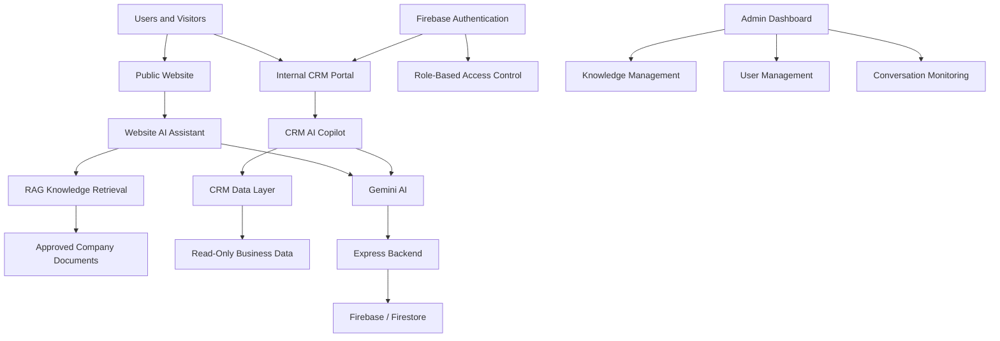

# 🌱 Sustain & Save — Dual AI Chatbot Platform

<p align="center">
  <strong>Enterprise AI Assistants for Smarter Customer Engagement & Business Intelligence</strong>
</p>

<p align="center">
  <a href="https://my-s3k9mdptja.brewpage.app/">🌐 Live Website</a> •
  <a href="https://sustain-save-dual-ai-chatbot-platform.ai.studio/">🤖 AI Studio App</a> •
  <a href="https://github.com/prachimahajan192008/sustain-save-dual-ai-chatbot">💻 GitHub Repository</a>
</p>

<p align="center">
  
  
  
  
  
</p>

---

## 🚀 Project Overview

**Sustain & Save – Dual AI Chatbot Platform** is an AI-powered enterprise solution developed for Sustain & Save by **NMD Pvt Ltd**.

The platform combines industrial energy management, sustainability advisory, customer engagement, and internal business intelligence through an intelligent dual-chatbot architecture.

Instead of using a single chatbot for every purpose, the platform provides two specialized AI assistants:

1. **Website AI Customer Assistant** – An intelligent public-facing chatbot that helps visitors understand company services, products, pricing, energy savings, and support information.
2. **CRM AI Copilot** – An internal AI assistant that enables authorized employees to retrieve CRM insights, analyze business data, and generate interactive reports through natural-language queries.

A centralized Admin Dashboard supports platform administration, knowledge management, user access, and conversation monitoring.

The platform is designed around a key principle:

**Public customer interactions and internal business intelligence must remain logically separated.**

## 🌐 Live Applications

| Platform | Link | Purpose |
|---|---|---|
| Official Website | [Visit Website](https://my-s3k9mdptja.brewpage.app/) | Public-facing Sustain & Save platform |
| Website AI | [Try Website AI](https://my-s3k9mdptja.brewpage.app/) | Customer assistance |
| CRM AI Platform | [Open AI Studio](https://sustain-save-dual-ai-chatbot-platform.ai.studio/) | Internal CRM AI experience |
| Source Code | [GitHub Repository](https://github.com/prachimahajan192008/sustain-save-dual-ai-chatbot) | Project implementation |

## ✨ Key Features

### 🤖 1. Website AI Customer Assistant

A Gemini-powered public chatbot designed to provide intelligent customer support around the clock.

**Features:**
- 24/7 AI-powered customer assistance.
- Context-aware answers using approved company knowledge sources.
- Retrieval-Augmented Generation (RAG) for relevant information retrieval.
- Product, service, pricing, and energy-saving information.
- Interactive charts for relevant pricing and energy-related queries.
- Suggested questions for faster interactions.
- Customer feedback and support escalation.
- Call and WhatsApp handoff when human assistance is needed.
- Conversation logging for administrative review.
- A no-guessing approach when approved information is unavailable.

### 📊 2. Internal CRM AI Copilot

An AI-powered business assistant built for authorized internal employees.

It allows employees to interact with CRM information using natural language instead of manually searching through records.

**Features:**
- Natural-language CRM queries.
- Lead and customer insights.
- Follow-up tracking and pending task analysis.
- Support ticket reporting.
- Customer breakdown and business summaries.
- Interactive Pie, Bar, and Line charts.
- Recharts-powered data visualization.
- Read-only CRM data access.
- Pre-trained knowledge covering 100 CRM workflow and SOP questions.

**Example queries:**
- How many leads are currently available?
- Show pending follow-ups.
- Give me a customer breakdown.
- How many support tickets were created this month?
- Generate a report of customer activity.

### 🛡️ 3. Role-Based Access Control (RBAC)

The platform provides differentiated access for internal users.

| Role | Access |
|---|---|
| Super Admin | Administrative access and platform management |
| CRM Admin | CRM administration and business insights |
| Staff | Authorized CRM queries and read-only assistance |

Authentication and authorization are supported through Firebase Authentication and Firestore security rules.

### ⚙️ 4. Admin Dashboard

A centralized interface for managing the AI platform.

**Capabilities include:**
- User and role management.
- Knowledge base management.
- Chatbot configuration.
- Conversation history monitoring.
- Support escalation management.
- Administrative controls.

### 🌿 5. Sustainability & Energy Intelligence

The Sustain & Save platform also highlights industrial energy optimization and ESG advisory.

Key areas include:
- EM-100 power telemetry.
- Industrial energy consumption monitoring.
- Scope 2 emissions advisory.
- Energy-saving insights.
- Sustainability-focused business intelligence.

The public website presents a target/reference of 12–18% six-month kWh reduction.

## 🏗️ System Architecture

The platform follows a dual-assistant architecture with shared infrastructure and separate access boundaries.



### Architecture Highlights

- **Frontend:** React and TypeScript provide the interactive application experience.
- **Backend:** Node.js and Express handle server-side API requests and business logic.
- **AI Engine:** Google Gemini powers conversational intelligence.
- **Knowledge Retrieval:** RAG provides relevant approved company context.
- **Database:** Firebase Firestore supports application data.
- **Authentication:** Firebase Authentication supports secure user access.
- **Authorization:** Role-based access and Firestore security rules help protect internal resources.
- **Visualization:** Recharts generates interactive business analytics.

## 🔐 Security & Data Isolation

Security is an important part of the dual-chatbot architecture.

The platform incorporates:

- Firebase Authentication.
- Google Sign-In.
- Role-Based Access Control.
- Firestore security rules.
- Server-side Gemini API integration.
- API request rate limiting.
- Read-only CRM query workflows.
- Separation between public customer support and internal CRM assistance.

**Design principle:** The CRM Copilot is intended to analyze and retrieve business information without modifying CRM records.

## 🛠️ Technology Stack

| Category | Technologies |
|---|---|
| Frontend | React 19, TypeScript |
| Styling | Tailwind CSS |
| Backend | Node.js, Express.js |
| AI Integration | Google Gemini API |
| AI SDK | Google GenAI SDK |
| Database | Firebase Firestore |
| Authentication | Firebase Authentication |
| Data Visualization | Recharts |
| Icons | Lucide React |
| Animation | Motion |
| Document Processing | Mammoth |
| Build Tool | Vite |
| Runtime / Development | Node.js, tsx |
| Version Control | Git & GitHub |

## 📁 Project Structure

```text
sustain-save-dual-ai-chatbot/
│
├── public/
│   └── assets/
│       └── aistudio/
│
├── src/
│   ├── assets/
│   ├── components/
│   ├── lib/
│   ├── types/
│   ├── App.tsx
│   ├── index.css
│   └── main.tsx
│
├── server/
│   ├── authVerify.ts
│   ├── crmDemoData.ts
│   ├── geminiService.ts
│   └── knowledgeStore.ts
│
├── data/
│
├── .env.example
├── firebase-applet-config.json
├── firebase-blueprint.json
├── firestore.rules
├── firestore.rules.test.ts
├── security_spec.md
├── server.ts
├── package.json
├── tsconfig.json
└── vite.config.ts
```

## ⚡ Installation & Setup

### Prerequisites

Make sure you have installed:

- Node.js
- npm
- Git
- Google Gemini API key
- Firebase project

### 1. Clone the Repository

```bash
git clone https://github.com/prachimahajan192008/sustain-save-dual-ai-chatbot.git
```

### 2. Navigate to the Project

```bash
cd sustain-save-dual-ai-chatbot
```

### 3. Install Dependencies

```bash
npm install
```

### 4. Configure Environment Variables

Create a `.env` file in the project root.

Add the following configuration:

```env
GEMINI_API_KEY=your_gemini_api_key

APP_URL=http://localhost:3000

SUPPORT_PHONE=your_support_phone
SUPPORT_WHATSAPP=your_whatsapp_number
SUPPORT_EMAIL=your_support_email
```

**Important:** Never commit your actual API keys, credentials, or private configuration files to GitHub.

### 5. Configure Firebase

1. Create a Firebase project.
2. Enable Firebase Authentication.
3. Configure Google Sign-In.
4. Set up Cloud Firestore.
5. Configure the Firebase application settings.
6. Update the Firebase configuration with your project details.
7. Review and deploy the provided Firestore security rules.

### 6. Start the Development Server

```bash
npm run dev
```

Open the local URL displayed in your terminal.

### 7. Build for Production

```bash
npm run build
```

### 8. TypeScript Validation

```bash
npm run lint
```

## 🔑 Environment Variables

| Variable | Description |
|---|---|
| `GEMINI_API_KEY` | Google Gemini API key |
| `APP_URL` | Application base URL |
| `SUPPORT_PHONE` | Support contact number |
| `SUPPORT_WHATSAPP` | WhatsApp support number |
| `SUPPORT_EMAIL` | Support email address |

## 🎯 Project Objectives

The primary objectives of Sustain & Save are:

1. Improve customer engagement through intelligent AI assistance.
2. Provide 24/7 access to approved company information.
3. Simplify internal CRM operations using natural-language queries.
4. Enable faster business decision-making through AI-generated insights.
5. Maintain separation between public and internal chatbot experiences.
6. Reduce manual effort in CRM reporting and information retrieval.
7. Support industrial energy optimization and sustainability awareness.

## 🚀 Future Enhancements

- Advanced CRM analytics and predictive insights.
- Expanded knowledge base and improved RAG retrieval.
- Production CRM integrations.
- Enhanced AI response evaluation.
- Advanced administrative reporting.
- Expanded energy consumption analytics.
- More detailed ESG reporting.
- Improved monitoring and observability.
- Scalable cloud infrastructure.

## 👩‍💻 Author

**Prachi Mahajan**

Developer & Project Contributor

GitHub: [@prachimahajan192008](https://github.com/prachimahajan192008)

## 🏢 Implementation Partner

**NMD Pvt Ltd**

Pune, Maharashtra, India

Official Website: [https://thedigitalnmd.com/](https://thedigitalnmd.com/)

## 🙏 Acknowledgements

- Google AI Studio and Gemini.
- Firebase.
- React and TypeScript communities.
- Sustain & Save.
- NMD Pvt Ltd.

---

<p align="center">
  <strong>🌱 Building smarter businesses through AI and sustainability.</strong>
</p>

<p align="center">
  ⭐ If you find this project interesting, consider starring the repository!
</p>
⭐ If you find this project interesting, consider giving the repository a star!
